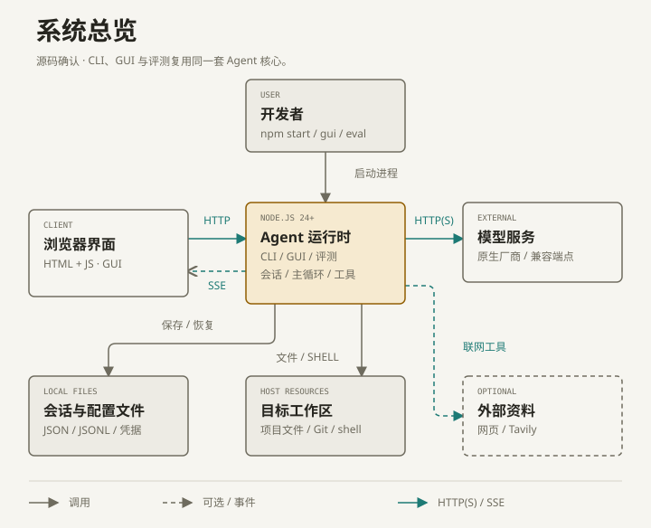
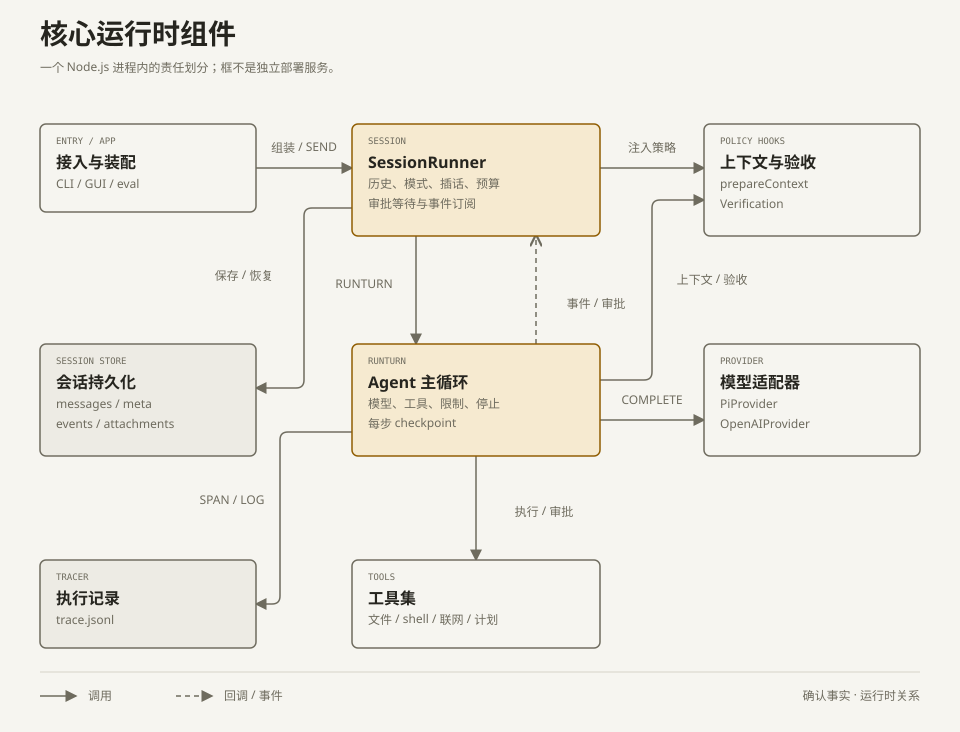
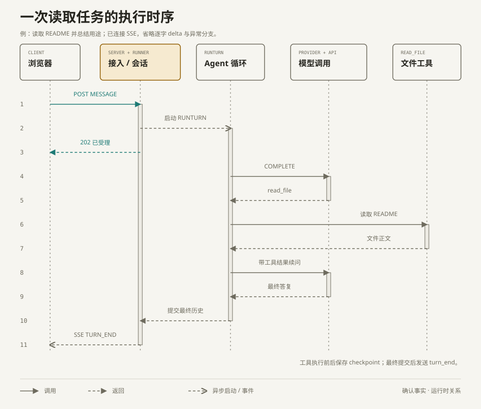

# 项目架构

这份文档描述本仓库实现的本地编码 Agent，面向首次阅读源码的开发者。源码核对基线为 `a8af7da`；图中的调用关系来自代码，**不代表已验证某台机器的在线服务或部署状态**。

范围包括 CLI、浏览器界面、共享 Agent 运行时、文件存储、工作区工具和两套评测入口。模型服务、Tavily、目标网页、Tailscale、Cloudflare、Docker 与待修改的项目属于外部依赖或执行环境。`opencode.json` 配置的是开发本仓库时使用的 OpenCode，不是 RawCodingAgent 的运行时入口。

## 1. 系统总览



[可编辑 HTML 源文件](architecture/overview.html) · [SVG](architecture/overview.svg)

图中箭头只表示运行时交互。Node.js 框内的 CLI、GUI、eval 是可选启动方式，共用核心代码；它们不是三个互相通过 HTTP 通信的后端服务。浏览器是独立客户端，GUI 的静态页面由同一个 Node.js 进程提供。

| 核心节点 / 关系 | 确认事实与源码依据 |
| --- | --- |
| 用户从终端启动 CLI、GUI 或评测 | [package.json](../package.json) 定义 `start`、`gui`、`eval`、`eval:swe`；[src/index.ts](../src/index.ts#L31) 解析参数，分发 CLI 或 GUI。评测有自己的入口。 |
| 浏览器通过 HTTP 提交任务、通过 SSE 接收事件 | [src/gui/index.html](../src/gui/index.html#L2298) 使用 `EventSource`；[src/gui/server.ts](../src/gui/server.ts#L115) 提供 `/events/:id`，`handleApi` 接收 `/api/sessions/:id/message`。 |
| 本地应用调用模型服务 | [src/app.ts](../src/app.ts#L68) 根据会话选择 `PiProvider` 或 `OpenAIProvider`；[src/providers/pi.ts](../src/providers/pi.ts#L99) 调用原生流式 SDK，[src/providers/openai.ts](../src/providers/openai.ts#L168) 调用兼容端点。API Key 留在服务端。 |
| 工具读取、修改工作区并运行命令 | [src/tools/index.ts](../src/tools/index.ts) 注册文件和 shell 工具；[src/tools/workspace.ts](../src/tools/workspace.ts) 检查文件工具的路径；[src/tools/bash.ts](../src/tools/bash.ts#L173) 创建宿主机子进程。Git worktree 管理由 [src/workspace/worktrees.ts](../src/workspace/worktrees.ts) 实现。 |
| 会话、设置与凭据写入本地文件 | [src/app.ts](../src/app.ts#L58) 确定数据位置；[src/session/store.ts](../src/session/store.ts#L154) 管理会话，凭据由 [src/providers/store.ts](../src/providers/store.ts) 保存。没有数据库或消息队列服务。 |
| 可选联网工具访问外部资料 | [src/app.ts](../src/app.ts#L79) 默认提供 `web_fetch`，配置搜索 key 后添加 `web_search`；实现见 [web-fetch.ts](../src/tools/web-fetch.ts)、[web-search.ts](../src/tools/web-search.ts)。评测入口关闭这两项工具。 |

### 主要运行单元与系统边界

| 运行单元 | 入口与职责 | 与其他单元的关系 |
| --- | --- | --- |
| 浏览器客户端 | `src/gui/*.html`、`common.js`、`theme.js`；会话、设置、统计与迭代记录 | HTTP 请求本机或代理入口；SSE 接收事件。前端没有独立构建或发布步骤。 |
| 交互式 Node.js 进程 | `src/index.ts`；CLI 或 GUI，共用 `createRuntime` / `SessionRunner` | 在宿主机调用模型、文件工具与 shell；GUI 可创建多个监听端口，但仍是一个进程。 |
| 自建任务评测进程 | `src/eval/index.ts`、`src/eval/runner.ts` | 在自己的进程中复用 Agent 核心；复制题目仓库到临时目录，执行后覆盖隐藏检查并评分。不会请求 GUI API。 |
| SWE-bench 评测进程 | `src/eval/swebench/index.ts`、`runner.ts` | Agent 与文件工具仍在宿主机；替换 `bash` 为 Docker 内执行，再用全新容器评分。 |
| shell / Git 子进程 | `src/tools/bash.ts`、`src/workspace/git.ts` | 按需启动；不是常驻任务队列或独立 Agent 服务。 |

`@earendil-works/pi-ai`、`openai`、`qrcode` 是进程内依赖，不是部署单元。前两者分别承担原生模型协议与 Chat Completions 兼容适配；`qrcode` 用于设备配对二维码。版本约束见 [package.json](../package.json)，实际安装版本由 [package-lock.json](../package-lock.json) 锁定。Node 24+ 直接执行 TypeScript，[tsconfig.json](../tsconfig.json) 仅做类型检查，不输出构建产物。

## 2. 核心运行时组件



[可编辑 HTML 源文件](architecture/components.html) · [SVG](architecture/components.svg)

本图展开一个 Node.js 进程内的核心责任。框表示组件，不表示独立进程。实线是运行时调用；虚线是回调或事件。静态导入关系另列在下一张表，避免把“导入文件”误读为“远程调用”。

| 核心节点 / 关键关系 | 确认事实与源码依据 |
| --- | --- |
| 接入与装配创建会话运行器 | [src/app.ts](../src/app.ts#L112) 的 `makeDeps` 注入 provider、工具、prompt、tracer 和 hooks；[src/gui/manager.ts](../src/gui/manager.ts) 按需管理运行器；[src/cli.ts](../src/cli.ts#L54) 和 [src/eval/runner.ts](../src/eval/runner.ts#L138) 直接创建 `SessionRunner`。 |
| `SessionRunner` 管理一段持续会话 | [src/session/runner.ts](../src/session/runner.ts#L178) 恢复历史、获取会话锁并接入 hooks；`send` / `drain` 管理任务和插话，`run` 调用 `runTurn`。命令与技能见 [session/commands.ts](../src/session/commands.ts)、[agent/skills.ts](../src/agent/skills.ts)。 |
| Agent 循环调用模型，再执行工具 | [src/agent/loop.ts](../src/agent/loop.ts#L270) 控制每步模型调用、工具批次、费用/步数/重复限制；`completeModel` 调用统一的 `Provider.complete`，`executeToolCall` 经过审批后调用 `Tool.run`。 |
| provider 统一协议与返回格式 | [src/types.ts](../src/types.ts#L76) 定义 `Provider`；[providers/pi.ts](../src/providers/pi.ts)、[providers/openai.ts](../src/providers/openai.ts) 转换消息、工具调用、流式 delta 和用量。模型目录与凭据由 [catalog.ts](../src/providers/catalog.ts)、[store.ts](../src/providers/store.ts) 管理。 |
| 工具审批与执行 | [src/agent/loop.ts](../src/agent/loop.ts#L150) 先调用 `needsApproval` / `confirm` 再执行；规则在 [permissions.ts](../src/agent/permissions.ts)。GUI 的等待审批通过 `approval_request` 事件和 `approve` 解锁，CLI 注入自己的确认函数。 |
| 上下文与完成检查作为 hooks 接入循环 | [src/session/runner.ts](../src/session/runner.ts#L747) 注入 `prepareContext`、`beforeTool`、`afterTool`、`completionCheck`；压缩在 `prepareContext`，验收在 [agent/verification.ts](../src/agent/verification.ts#L140)。未完成计划或未通过验证时返回 `unverified`。 |
| checkpoint 与事件回到会话，再落盘 | [src/session/runner.ts](../src/session/runner.ts#L198) 将 `onStep` 接到 `saveStep`，将 `onEvent` 接到事件订阅；[src/session/store.ts](../src/session/store.ts#L284) 原子保存消息、追加事件。逐字 delta 只直播，完整消息和可回放事件才保存。 |
| tracer 记录模型与工具执行 | [src/agent/loop.ts](../src/agent/loop.ts#L182) 创建 tool / llm span；[src/agent/trace.ts](../src/agent/trace.ts) 脱敏并写 JSONL；[src/trace/analyze.ts](../src/trace/analyze.ts) 从文件计算统计，不是外部遥测服务。 |

### 静态代码依赖

以下仅表示源码 `import` 与接口实现，不表示网络或部署关系。

| 依赖方 | 被依赖模块 | 目的 |
| --- | --- | --- |
| [index.ts](../src/index.ts)、[eval/index.ts](../src/eval/index.ts)、[eval/swebench/index.ts](../src/eval/swebench/index.ts) | [app.ts](../src/app.ts) | 复用 `createRuntime`，各自启动执行流程。 |
| [app.ts](../src/app.ts) | `providers/`、`tools/`、`session/store.ts`、`gui/settings.ts`、`workspace/store.ts` | 组装依赖与本地存储；没有借用 Pi 的 Agent loop。 |
| [session/runner.ts](../src/session/runner.ts) | `agent/loop.ts`、`agent/context.ts`、`agent/verification.ts`、`agent/skills.ts`、`workspace/worker.ts` | 实现会话生命周期、压缩、验收、技能与子 Agent。 |
| [agent/loop.ts](../src/agent/loop.ts) | `types.ts`、`tools/types.ts`、权限/限制/截断模块 | 通过 `Provider` / `Tool` 契约调用具体实现，不直接导入两种 provider 类。 |
| [providers/pi.ts](../src/providers/pi.ts)、[providers/catalog.ts](../src/providers/catalog.ts) | `@earendil-works/pi-ai` | 原生协议、模型目录与流式传输。 |
| [providers/openai.ts](../src/providers/openai.ts) | `openai` | Chat Completions 兼容端点。 |

### 可选多 Agent 分支

`/multiagent` 开启后，`multi_agent` 工具回调到 `SessionRunner.spawnAgents`，在**同一 Node.js 进程**里并发调用 `runTurn`，不是另起 Agent 服务或分布式 worker。每个子 Agent 有独立历史，费用与停止信号归父任务管理。

- `scout` 读取父工作区当前文件，只拿只读工具，因此可以读到父工作区尚未提交的文件内容。
- `worker` 从当前提交创建独立 Git worktree；父工作区未提交的改动不随之迁移。`.worktreeinclude` 指定的未跟踪文件可被复制。
- 返回的是总结、分支与改动信息；不会自动合并。Git worktree 隔离文件版本，不是 shell 安全沙箱。

依据：[src/tools/multi-agent.ts](../src/tools/multi-agent.ts)、[src/session/runner.ts](../src/session/runner.ts#L316)、[src/workspace/worker.ts](../src/workspace/worker.ts)。

## 3. 典型任务时序

场景：在已建立 SSE 连接的本地 GUI 会话里，发送“读取 README 并总结项目用途”。模型先调用 `read_file`，拿到结果后给出最终答复。这个场景没有写操作，所以无需人工审批，也不触发文件改动验收。



[可编辑 HTML 源文件](architecture/task-sequence.html) · [SVG](architecture/task-sequence.svg)

图将 HTTP 路由与 `SessionRunner` 合并为“接入 / 会话”，将 provider 适配器与模型服务合并为“模型调用”；只是为了控制时序图宽度，不改变前两图的进程边界。文件存储和逐字 delta 以旁注说明。

| 步骤 / 关系 | 确认事实与源码依据 |
| --- | --- |
| 1–3：提交、启动、确认受理 | [src/gui/server.ts](../src/gui/server.ts#L290) 校验消息并调用 `runner.send`，返回 HTTP `202 {ok, queued}`；[src/session/runner.ts](../src/session/runner.ts#L451) 启动 `drain` / `run`。202 只代表已受理，不代表任务完成。 |
| 4–5：模型决定调用工具 | [src/agent/loop.ts](../src/agent/loop.ts#L338) 准备上下文并调用模型；[src/types.ts](../src/types.ts#L62) 的响应携带文字、工具调用、停止原因和用量。 |
| 6–7：执行读取 | [src/agent/loop.ts](../src/agent/loop.ts#L150) 校验工具、判断审批并执行；[src/tools/read-file.ts](../src/tools/read-file.ts) 读取工作区内的文件。执行前后均通过 `onStep` 保存 checkpoint。 |
| 8–9：带工具结果再次调用模型 | [src/agent/loop.ts](../src/agent/loop.ts#L409) 把结果写回 `tool_results`，下一步重新调用模型；没有工具调用时走结束分支。模型可能继续调用工具，图中只画一轮读取。 |
| 10–11：保存最终历史并通知页面 | [src/agent/loop.ts](../src/agent/loop.ts#L366) 判定结束；[src/session/runner.ts](../src/session/runner.ts#L769) 提交消息并生成 `turn_end`；[src/gui/server.ts](../src/gui/server.ts#L115) 将事件转成 SSE。 |

写操作的差异：在 `ask` 模式下，受控工具执行前通过 SSE 发 `approval_request`，浏览器 POST `/api/sessions/:id/approve` 后才继续。修改完成后需要 `verify_changes`，未验证或计划未完成会以 `unverified` 结束。停止、超限、协议错误等分支不在本图展开，分别见 [permissions.ts](../src/agent/permissions.ts)、[verification.ts](../src/agent/verification.ts)、[loop.ts](../src/agent/loop.ts)。

## 4. 部署关系与持久化

以下描述**代码支持的部署方式**，不是当前机器已启用的服务清单。仓库没有独立前端构建、应用 Dockerfile、Compose、Kubernetes 或 CI 部署清单；远程入口靠参数、环境配置和外部代理，SWE-bench 容器由代码启动。

| 模式 / 部署关系 | 运行位置与链路 | 依据 |
| --- | --- | --- |
| 本地 GUI | 浏览器连接 `127.0.0.1:4317`（默认）；Node.js 使用 Host 校验和启动 token 保护 API / 事件流 | [index.ts](../src/index.ts#L63)、[gui/server.ts](../src/gui/server.ts#L437)；静态页面资源和配对入口有单独路由规则，不应概括为所有资源都要求 token。 |
| Tailscale，可选 | 远程浏览器经 Tailscale Serve 的 HTTPS 入口，转发至 Node.js 的另一个随机 loopback 端口 | [index.ts](../src/index.ts#L88)、[remote/tailscale.ts](../src/gui/remote/tailscale.ts)、[remote/access.ts](../src/gui/remote/access.ts)；同账号身份、Host / Origin 与设备凭证检查。 |
| Cloudflare，可选 | 浏览器经 Cloudflare Access / Tunnel，由外部 `cloudflared` 转发至 `127.0.0.1:4318`（默认） | [index.ts](../src/index.ts#L80)、[remote/cf-access.ts](../src/gui/remote/cf-access.ts)、[.env.example](../.env.example)；应用再验 JWT、邮箱与设备凭证。应用不负责启动 `cloudflared`。配置步骤见 [README](../README.md#从公网访问cloudflare-tunnel--access)。 |
| 自建评测 | Node.js 在宿主机临时目录运行 Agent；随后安装隐藏检查并运行检查命令 | [eval/runner.ts](../src/eval/runner.ts#L195)、[eval/tasks.ts](../src/eval/tasks.ts)。不是容器隔离；移除联网工具不等于隔离 shell 网络。 |
| SWE-bench | 宿主机文件工具操作临时 checkout；相同绝对路径挂载到 Agent 容器；提取 patch 后用全新容器评分 | [swebench/docker.ts](../src/eval/swebench/docker.ts)、[runner.ts](../src/eval/swebench/runner.ts#L36)、[grade.ts](../src/eval/swebench/grade.ts#L52)。`uv` / Python helper 调用官方 `swebench` 包。 |

| 数据位置（默认） | 内容 / 生命周期 | 依据 |
| --- | --- | --- |
| 项目根目录 `.sessions/<id>/` | `meta.json`、`messages.json`、`events.jsonl`、`trace.jsonl`、附件；CLI / GUI 可恢复同一会话，会话锁阻止并行占用 | [app.ts](../src/app.ts#L61)、[session/store.ts](../src/session/store.ts)。 |
| 项目根目录 `.settings.json`、`.projects.json`、`.worktrees.json` | 默认模型 / 限额 / 指令、已打开项目、应用创建的 worktree 记录 | [app.ts](../src/app.ts#L63)、[workspace/store.ts](../src/workspace/store.ts)。 |
| `~/.raw-coding-agent/providers.json` | 厂商凭据；权限 `0600`；页面只接收掩码 | [app.ts](../src/app.ts#L67)、[providers/store.ts](../src/providers/store.ts)。 |
| `.devices.json`、`.audit.jsonl` | 远程设备凭证哈希与远程审计；仅相关入口启用时使用 | [index.ts](../src/index.ts#L69)、[remote/devices.ts](../src/gui/remote/devices.ts)、[remote/audit.ts](../src/gui/remote/audit.ts)。 |
| `.eval-runs/<run>/`、`.eval-runs/swe/<run>/` | 评测结果和独立 sessions；SWE-bench 另含 patch、脚本、日志与报告 | [eval/index.ts](../src/eval/index.ts)、[swebench/index.ts](../src/eval/swebench/index.ts)。 |

## 5. 事实、推断与待确认项

- **确认事实（源码）**：以上节点、关系、存储位置和入口均有对应实现。应用不依赖数据库或消息队列，Agent loop 自研，Pi 只用于模型接入。文件工具有工作区约束，普通 `bash` 仍在宿主机执行。`sanitizeToolEnv` 过滤常见凭据环境变量，但不阻止 shell 读取宿主机上可访问的文件。
- **合理推断**：本项目主要面向个人在自己电脑上学习与运行 Agent。依据是 README 定位、loopback 监听、同账号远程校验和文件存储；这不构成经过验证的多租户隔离或容量承诺。
- **待确认（运行环境）**：实际启用哪种模型 / base URL、账号可访问哪些模型、Tailscale 与 Cloudflare 是否已部署、宿主机访问策略和并发容量。没有读取真实凭据或为架构分析发起付费模型调用。

## 6. 图源与维护

`docs/architecture/*.html` 是自包含、可编辑的 HTML + 内联 SVG 源文件；同名 `.svg` 是供 README / Markdown 展示的导出物。用浏览器打开 HTML 即可查看，宽图在小屏内局部横向滚动。修改时同步更新同名 SVG 与图后证据，避免图片和文档各说一套。

分析采用 [c4-codebase-architecture](https://github.com/lmammino/c4-codebase-architecture-skill)，排版采用 [diagram-design](https://github.com/cathrynlavery/diagram-design)。没有增加项目运行依赖。

安装 diagram-design 后可用其导出与检查脚本（`<skill-dir>` 指该 skill 的安装目录）：

```bash
python3 <skill-dir>/scripts/self_check.py --offline docs/architecture/overview.html
python3 <skill-dir>/scripts/export_svg.py docs/architecture/overview.html docs/architecture/overview.svg --system-fonts
```

`components`、`task-sequence` 同理。自检不能替代视觉检查：在浏览器里检查中文标签、箭头端点、交叉与小屏滚动，再检查导出的 SVG。
